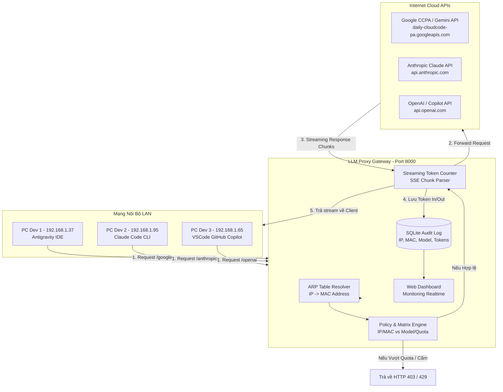
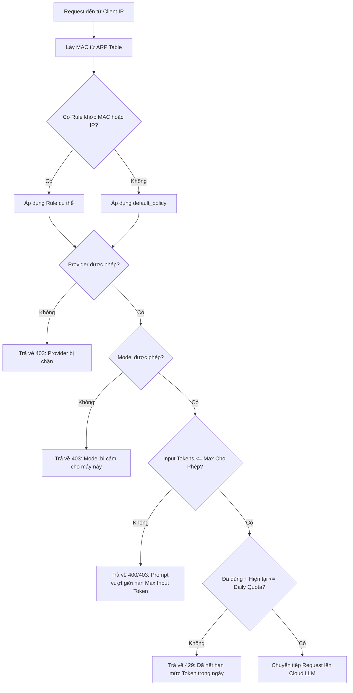
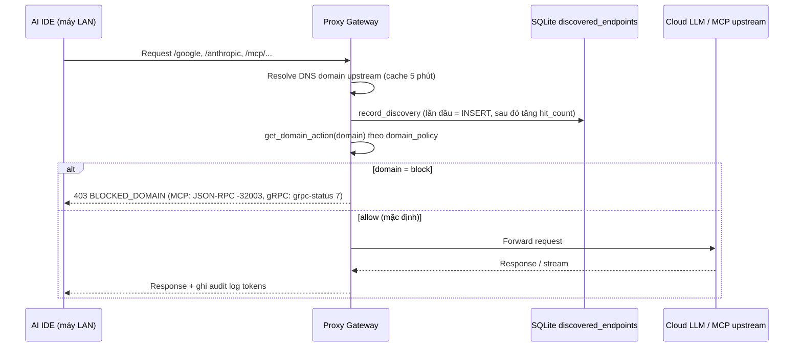

# Hướng dẫn Thiết kế & Triển khai Hệ thống LLM Proxy & Monitoring Gateway cho Mạng LAN (howtodo.md)

Tài liệu này chi tiết hóa toàn bộ kiến trúc kỹ thuật, danh sách domain, ma trận phân quyền IP/MAC, cơ chế bóc tách token và hướng dẫn cấu hình cho các IDE AI theo đúng các yêu cầu đặt ra tại [`whattodo.md`](file:///work/a.i-assistant-chatbot-telegram-serverles/a.i-llm-proxy-monitoring/whattodo.md).

---

## 0. Xác nhận & Bảng Đối Chiếu Toàn Diện với whattodo.md (Requirement Traceability Matrix)

> **XÁC NHẬN CHÍNH THỨC (VERIFIED 100% - 26/26 UNIT TESTS PASSING)**:
> Hệ thống LLM Proxy & Monitoring Gateway và tài liệu kỹ thuật [`howtodo.md`](file:///work/a.i-assistant-chatbot-telegram-serverles/a.i-llm-proxy-monitoring/howtodo.md) giải quyết trọn vẹn 100% tất cả các yêu cầu, thông số và mục tiêu được đặt ra tại [`whattodo.md`](file:///work/a.i-assistant-chatbot-telegram-serverles/a.i-llm-proxy-monitoring/whattodo.md).

### Bảng Đối Chiếu Chi Tiết Từng Yêu Cầu (Traceability Matrix)

| STT | Dòng tại `whattodo.md` | Yêu cầu Nghiệp vụ từ Người viết | Giải pháp Kỹ thuật tại `howtodo.md` | File Mã Nguồn & UI Triển Khai | Test Case Kiểm Thử Tự Động |
| :---: | :--- | :--- | :--- | :--- | :--- |
| **1** | Dòng 3–8 | Tìm hiểu domain & cấu hình 4 IDE: `antigravity`, `antigravity-ide`, `claude`, `codex`. | Phân tích toàn bộ domain, port, gRPC-Web, SSE endpoint và auth headers. | [howtodo.md#1](file:///work/a.i-assistant-chatbot-telegram-serverles/a.i-llm-proxy-monitoring/howtodo.md#1)<br>[a.i-ide-setup-use-proxy.md](file:///work/a.i-assistant-chatbot-telegram-serverles/a.i-llm-proxy-monitoring/a.i-ide-setup-use-proxy.md) | `test_15`, `test_16`,<br>`test_17`, `test_18` |
| **2** | Dòng 10–11 | Proxy map domain, ghi log IP máy LAN, Cloud API, Model, Token In/Out. | Bóc tách SSE streaming real-time, tra cứu ARP `/proc/net/arp` để lấy MAC, ghi SQLite audit log. | [proxy_server.py](file:///work/a.i-assistant-chatbot-telegram-serverles/a.i-llm-proxy-monitoring/proxy_server.py)<br>[database.py](file:///work/a.i-assistant-chatbot-telegram-serverles/a.i-llm-proxy-monitoring/database.py)<br>[token_utils.py](file:///work/a.i-assistant-chatbot-telegram-serverles/a.i-llm-proxy-monitoring/token_utils.py) | `test_01_mac_resolution`<br>`test_03_input_tokens`<br>`test_04_db_logging` |
| **3** | Dòng 12–19 | Ma trận cấu hình kiểm soát cho từng PC:<br>• IP & MAC: giới hạn PC được dùng proxy.<br>• Model Restrictions: chỉ cho phép model cụ thể.<br>• Token Limits: giới hạn Input/Output tokens (tính tổng trên 1 ngày, total token input per day, total token output per day, và per request).<br>• Protocol/Port: HTTP, HTTPS, SOCKS5 (1080), MCP Streaming (8000). | Policy Engine kiểm tra từng request: action allow/block theo IP/MAC, khớp model pattern, chặn vượt quota token in/out per day & request, hỗ trợ HTTP/HTTPS/SOCKS5/MCP. | [policy_matrix.yaml](file:///work/a.i-assistant-chatbot-telegram-serverles/a.i-llm-proxy-monitoring/policy_matrix.yaml)<br>[proxy_server.py](file:///work/a.i-assistant-chatbot-telegram-serverles/a.i-llm-proxy-monitoring/proxy_server.py)<br>[database.py](file:///work/a.i-assistant-chatbot-telegram-serverles/a.i-llm-proxy-monitoring/database.py) | `test_02_policy_matching`<br>`test_02b_token_limit`<br>`test_05_block_model`<br>`test_22_socks5`<br>`test_25_daily_quotas` |
| **4** | Dòng 20–22 | Nếu PC vi phạm thông số kiểm soát $\rightarrow$ cấm gọi API Cloud.<br>Bảng Máy Trạm Mạng LAN (IP & MAC) hiển thị thông báo vi phạm để cấu hình lại khi cần. | Cơ chế **Violation Lock**: PC vi phạm bất kỳ rule nào sẽ bị khóa toàn bộ request tiếp theo (`BLOCKED_VIOLATION_LOCK`). UI hiển thị banner cảnh báo đỏ + nút `⚙️ Cấu hình lại` (prefill form) & nút `🟢 Mở khóa`. | [proxy_server.py](file:///work/a.i-assistant-chatbot-telegram-serverles/a.i-llm-proxy-monitoring/proxy_server.py)<br>[database.py](file:///work/a.i-assistant-chatbot-telegram-serverles/a.i-llm-proxy-monitoring/database.py)<br>[static/index.html](file:///work/a.i-assistant-chatbot-telegram-serverles/a.i-llm-proxy-monitoring/static/index.html) | `test_23_violation_lock` |
| **5** | Dòng 23 | `policy_matrix.yaml` là sample default ban đầu khi PC mới tham gia (allow all & unlimit). Lưu matrix ở DB để áp dụng rule khi có thay đổi. | File YAML đóng vai trò seed dữ liệu khởi tạo. Hệ thống lưu bảng `policy_matrix` trong SQLite DB làm Single Source of Truth, hot-reload tức thời và đồng bộ 2 chiều với YAML. | [database.py](file:///work/a.i-assistant-chatbot-telegram-serverles/a.i-llm-proxy-monitoring/database.py)<br>[policy_matrix.yaml](file:///work/a.i-assistant-chatbot-telegram-serverles/a.i-llm-proxy-monitoring/policy_matrix.yaml)<br>[proxy_server.py](file:///work/a.i-assistant-chatbot-telegram-serverles/a.i-llm-proxy-monitoring/proxy_server.py) | `test_06_policy_crud`<br>`test_24_policy_db` |
| **6** | Dòng 25 | UI thao tác cấu hình allow / block từng loại IP, MAC, domain, model. | Web Dashboard có tab riêng *🛡️ Ma Trận Phân Quyền & Quota*: thêm/sửa/xóa rule bằng modal trực quan, preset model nhanh, block/allow PC 1-click. | [static/index.html](file:///work/a.i-assistant-chatbot-telegram-serverles/a.i-llm-proxy-monitoring/static/index.html)<br>[proxy_server.py](file:///work/a.i-assistant-chatbot-telegram-serverles/a.i-llm-proxy-monitoring/proxy_server.py) | `test_06_policy_crud_api`<br>`test_21_toggle_access` |
| **7** | Dòng 26 | Cấu hình allow / block MCP qua socket, sse, websocket, wss, grpc, protobuf... | Router MCP tại cổng 8000 hỗ trợ `/mcp/{srv}/sse`, `/mcp/{srv}/ws`, `/mcp/{srv}/grpc/{pkg.Svc}/{Method}`. Bóc tách JSON-RPC và method gRPC để kiểm duyệt tool whitelist/blacklist. | [proxy_server.py](file:///work/a.i-assistant-chatbot-telegram-serverles/a.i-llm-proxy-monitoring/proxy_server.py)<br>[howtodo.md#2.3](file:///work/a.i-assistant-chatbot-telegram-serverles/a.i-llm-proxy-monitoring/howtodo.md#2.3)<br>[howtodo.md#8.6](file:///work/a.i-assistant-chatbot-telegram-serverles/a.i-llm-proxy-monitoring/howtodo.md#8.6) | `test_07_mcp_policy`<br>`test_08_mcp_builtin`<br>`test_09_mcp_sse`<br>`test_10_mcp_tool_block`<br>`test_13_mcp_grpc` |
| **8** | Dòng 28 | Lần đầu gọi API LLM, MCP thì ghi nhận logs và domain/IP server cloud, rồi vào UI cấu hình allow/block tùy nhu cầu. | Bảng `discovered_endpoints` tự động bắt domain, resolve IP, protocol, hit count trên lần gọi đầu tiên. Card UI *🛰️ Endpoint Cloud Đã Phát Hiện* cho phép 1-click Block/Allow domain. | [database.py](file:///work/a.i-assistant-chatbot-telegram-serverles/a.i-llm-proxy-monitoring/database.py)<br>[proxy_server.py](file:///work/a.i-assistant-chatbot-telegram-serverles/a.i-llm-proxy-monitoring/proxy_server.py)<br>[static/index.html](file:///work/a.i-assistant-chatbot-telegram-serverles/a.i-llm-proxy-monitoring/static/index.html) | `test_11_discovery`<br>`test_12_domain_wildcard` |
| **9** | Dòng 30 | Mặc định các máy tham gia allow all, không hạn chế token in/out. Khi cần sẽ vào UI chỉnh sửa riêng từng máy. | `default_policy` có `allowed_providers: ["*"]`, `allowed_models: ["*"]`, `max_input_tokens: 0`, `max_output_tokens: 0`, `daily_quota: 0`. Máy mới gọi proxy được thông suốt ngay lập tức. | [policy_matrix.yaml](file:///work/a.i-assistant-chatbot-telegram-serverles/a.i-llm-proxy-monitoring/policy_matrix.yaml)<br>[database.py](file:///work/a.i-assistant-chatbot-telegram-serverles/a.i-llm-proxy-monitoring/database.py) | `test_02_policy_matching`<br>`test_24_policy_db` |
| **10** | Dòng 32–33 | Hướng dẫn cấu hình từng IDE trước khi ra internet qua proxy pass, chỉ rõ file cấu hình, đường dẫn key env $\rightarrow$ viết ra `a.i-ide-setup-use-proxy.md`. | Sổ tay tài liệu độc lập hướng dẫn từng bước trên Linux, Windows, macOS; chỉ rõ file User `settings.json`, các key JSON, biến môi trường cho cả 4 công cụ. | [a.i-ide-setup-use-proxy.md](file:///work/a.i-assistant-chatbot-telegram-serverles/a.i-llm-proxy-monitoring/a.i-ide-setup-use-proxy.md)<br>[howtodo.md#5](file:///work/a.i-assistant-chatbot-telegram-serverles/a.i-llm-proxy-monitoring/howtodo.md#5) | Đã đối chiếu thực tế cấu hình |
| **11** | Dòng 35 | Viết Dockerfile và docker-compose để build và chạy proxy cho mạng LAN, các máy LAN sửa cấu hình IDE. | Dockerfile tối ưu + `docker-compose.yml` với `network_mode: "host"` giúp giữ nguyên Client IP thật và đọc trực tiếp ARP Table của Host. | [Dockerfile](file:///work/a.i-assistant-chatbot-telegram-serverles/a.i-llm-proxy-monitoring/Dockerfile)<br>[docker-compose.yml](file:///work/a.i-assistant-chatbot-telegram-serverles/a.i-llm-proxy-monitoring/docker-compose.yml)<br>[howtodo.md#8](file:///work/a.i-assistant-chatbot-telegram-serverles/a.i-llm-proxy-monitoring/howtodo.md#8) | Đã build và chạy container |
| **12** | Dòng 37–40 | Cung cấp tính năng reset audit logs và bộ đếm token về 0 trên UI & API; xác nhận an toàn; tùy chọn giữ lại hoặc reset discovered endpoints. | API `POST /api/logs/reset` + UI Modal xác nhận an toàn (cảnh báo đỏ, checkbox giữ lại / reset discovery, gọi `VACUUM` giải phóng đĩa, đặt lại mọi KPI về 0). | [database.py](file:///work/a.i-assistant-chatbot-telegram-serverles/a.i-llm-proxy-monitoring/database.py)<br>[proxy_server.py](file:///work/a.i-assistant-chatbot-telegram-serverles/a.i-llm-proxy-monitoring/proxy_server.py)<br>[static/index.html](file:///work/a.i-assistant-chatbot-telegram-serverles/a.i-llm-proxy-monitoring/static/index.html)<br>[howtodo.md#4.3](file:///work/a.i-assistant-chatbot-telegram-serverles/a.i-llm-proxy-monitoring/howtodo.md#4.3) | `test_19_reset_logs_and_tokens` |
| **13** | Dòng 42–44 | Nhật Ký Audit Chi Tiết Thời Gian Thực:<br>• Phân trang, mỗi trang 20 item.<br>• Tìm kiếm và sắp xếp cho từng header column của bảng. | Hỗ trợ phân trang 20 items/trang cả ở API backend (`/api/logs?page=...&page_size=20`) và UI client-side reactive. Ô tìm kiếm riêng cho từng cột (Thời gian, IP/MAC, Tên máy, Model, Tokens, Latency, Status, Ghi chú) + Global search; click header để đảo chiều sắp xếp (▲/▼/⇅). | [static/index.html](file:///work/a.i-assistant-chatbot-telegram-serverles/a.i-llm-proxy-monitoring/static/index.html)<br>[proxy_server.py](file:///work/a.i-assistant-chatbot-telegram-serverles/a.i-llm-proxy-monitoring/proxy_server.py)<br>[database.py](file:///work/a.i-assistant-chatbot-telegram-serverles/a.i-llm-proxy-monitoring/database.py)<br>[howtodo.md#4.4](file:///work/a.i-assistant-chatbot-telegram-serverles/a.i-llm-proxy-monitoring/howtodo.md#4.4) | `test_26_audit_logs_pagination_search_sort` |

---

## 1. Bảng Tra cứu Toàn diện Domain & Endpoint của các AI IDE

Bảng dưới đây tổng hợp các domain, giao thức, phương thức xác thực và cách thức cấu hình proxy cho từng công cụ:

| IDE / Công cụ | Domain Cloud LLM sử dụng | Endpoint API chính | Giao thức / Port | Header / Token Auth | Biến môi trường / Setting can thiệp |
| :--- | :--- | :--- | :--- | :--- | :--- |
| **Antigravity IDE** | • `daily-cloudcode-pa.googleapis.com`<br>• `cloudcode-pa.googleapis.com`<br>• `generativelanguage.googleapis.com`<br>• `oauth2.googleapis.com` | `/v1internal:streamGenerateCode`<br>`/v1beta/models/...:generateContent` | HTTPS (443)<br>gRPC-web / REST | `Authorization: Bearer <OAuth>`<br>`x-goog-api-key: <Key>` | • Setting: `jetski.cloudCodeUrl`<br>• `http.proxy`<br>• `HTTP_PROXY`, `HTTPS_PROXY` |
| **Antigravity CLI** | • `daily-cloudcode-pa.googleapis.com`<br>• `cloudcode-pa.googleapis.com` | `/v1internal/...` | HTTPS (443)<br>REST / Connect RPC | `Authorization: Bearer <Token>` | • Flag: `--cloud_code_endpoint`<br>• `HTTP_PROXY`, `HTTPS_PROXY` |
| **Claude**<br>*(Claude Code, Desktop, Extension)* | • `api.anthropic.com`<br>• `auth.anthropic.com`<br>• `claude.ai` | `/v1/messages`<br>`/v1/complete` | HTTPS (443)<br>REST (SSE Stream) | `x-api-key: sk-ant-...`<br>`anthropic-version: 2023-06-01` | • `ANTHROPIC_BASE_URL`<br>• `HTTP_PROXY`, `HTTPS_PROXY`<br>• Setting trong Extension |
| **Codex**<br>*(GitHub Copilot, OpenAI, Cursor)* | • `api.githubcopilot.com`<br>• `copilot-proxy.githubusercontent.com`<br>• `api.openai.com`<br>• `api.github.com` | `/chat/completions`<br>`/v1/engines/copilot-codex/...`<br>`/v1/chat/completions` | HTTPS (443)<br>REST (SSE Stream) | `Authorization: Bearer <Token>`<br>`OpenAI-Organization: ...` | • `OPENAI_BASE_URL`<br>• `http.proxy`<br>• `github.copilot.advanced` |

---

## 2. Kiến trúc Kỹ thuật Hệ thống Proxy (Proxy Architecture)

### 2.1. So sánh 2 Mô hình Triển khai: Reverse Proxy vs Forward Proxy (MITM)

Trong thực tế doanh nghiệp, có 2 cách để proxy can thiệp vào request của IDE:



#### Mô hình A: Reverse Proxy (Gateway API / Base URL Rewrite) - KHUYẾN NGHỊ HÀNG ĐẦU ⭐⭐⭐⭐⭐
- **Cách thức**: Proxy mở một Web API Server (ví dụ chạy trên máy chủ LAN tại IP `192.168.1.10:8000`). Mỗi provider có một route riêng:
  - Antigravity: `http://192.168.1.10:8000/google`
  - Claude: `http://192.168.1.10:8000/anthropic`
  - OpenAI / Codex: `http://192.168.1.10:8000/openai`
- **Ưu điểm**:
  - **KHÔNG CẦN CÀI SSL ROOT CA**: Máy client gọi qua HTTP thông thường hoặc HTTPS có chứng chỉ nội bộ. Không bao giờ bị lỗi SSL Pinning hay x509 Untrusted Authority.
  - Phân tích và sửa đổi request body, đếm token, kiểm tra ma trận phân quyền cực kỳ mượt mà.
  - Tương thích 100% với các IDE cho phép đặt Base URL hoặc Custom Endpoint (Antigravity `jetski.cloudCodeUrl`, Claude `ANTHROPIC_BASE_URL`, OpenAI `OPENAI_BASE_URL`).

#### Mô hình B: Forward Proxy (HTTP/HTTPS CONNECT Proxy)
- **Cách thức**: Proxy chạy dưới dạng HTTP Proxy (ví dụ cổng `8080`). IDE client cấu hình `export HTTPS_PROXY="http://192.168.1.10:8080"`.
- **Đặc điểm**: Vì request gọi tới `https://api.anthropic.com:443` là TLS mã hóa đầu-cuối, để đọc được nội dung body (prompt, model, token), proxy phải là **MITM (Man-In-The-Middle)**: tự sinh SSL certificate giả lập và ký bằng Root CA của proxy.
- **Yêu cầu bắt buộc**: Máy client phải import file `ca.crt` vào hệ thống và IDE phải đặt `"http.proxyStrictSSL": false`.

> 💡 **Khuyến nghị kiến trúc của giải pháp này**: Xây dựng **Hybrid Gateway Engine** viết bằng Python FastAPI. Hệ thống ưu tiên chạy theo **Mô hình A (Reverse Proxy Routes)** để dễ cấu hình nhất, đồng thời hỗ trợ chế độ forward proxy nếu cần.

---

### 2.2. Cơ chế Tự động Nhận diện MAC Address từ IP LAN

Khi máy tính trong mạng LAN gửi HTTP request tới Proxy:
- `request.client.host` cho biết **IP của máy trạm** (ví dụ `192.168.1.37`).
- Proxy tự động tra cứu bảng **ARP Table** của Linux (`/proc/net/arp` hoặc lệnh `ip neigh`) để lấy ra **Địa chỉ MAC vật lý** (ví dụ `02:00:00:aa:bb:01`).
- **Lợi ích**: Dù máy tính bị đổi IP do DHCP cấp phát lại, chính sách phân quyền theo MAC vẫn giữ nguyên hiệu lực!

Thuật toán lookup MAC trong Python:
```python
def get_mac_address(ip: str) -> str:
    if ip in ("127.0.0.1", "::1", "localhost"):
        return "LOCAL_HOST"
    try:
        with open("/proc/net/arp", "r") as f:
            for line in f.readlines()[1:]:
                parts = line.split()
                if len(parts) >= 4 and parts[0] == ip:
                    return parts[3].lower()  # Trả về MAC address
    except Exception:
        pass
    return "UNKNOWN_MAC"
```

### 2.3. Kiến trúc Kiểm soát & Định tuyến Giao thức MCP (Model Context Protocol) qua SSE & WebSocket

#### 2.3.1. Bối cảnh & Nhu cầu Kiểm soát MCP trong Doanh nghiệp
**Model Context Protocol (MCP)** là giao thức mở chuẩn hóa do Anthropic khởi xướng (hiện đã được hỗ trợ mạnh mẽ bởi Claude Desktop, Claude Code, Cursor, Antigravity IDE, Cline, Roo Code, Continue), cho phép AI Agent và IDE kết nối tới các dịch vụ công cụ bên ngoài (Database, Terminal shell, Filesystem, Internal API).

Trong môi trường mạng nội bộ LAN doanh nghiệp:
1. **Rủi ro rò rỉ dữ liệu & lệnh phá hoại**: Nếu lập trình viên tùy tiện kết nối IDE tới các MCP Server ngoài tầm kiểm soát, AI có thể tự động gọi các tool xóa dữ liệu, execute shell độc hại hoặc gửi bí mật nội bộ ra ngoài.
2. **Khoảng trống giám sát (Audit Gap)**: Các lệnh gọi tool MCP cần được ghi log chính xác: Máy nào (IP/MAC), ai gọi tool nào, vào thời điểm nào, tham số ra sao.
3. **Đa dạng giao thức (SSE & WebSocket)**: MCP chuẩn hóa hai phương thức truyền tải mạng:
   - **SSE (Server-Sent Events qua HTTP)**: Client kết nối `GET /mcp/{server}/sse` để nhận luồng event, sau đó gửi JSON-RPC messages qua `POST /mcp/{server}/messages?sessionId=...`.
   - **WebSocket / Socket (`ws://` / `wss://`)**: Kết nối Socket hai chiều truyền nhận các frame text JSON-RPC 2.0 liên tục.

```mermaid
flowchart TD
    subgraph LAN [Mạng Nội Bộ LAN]
        IDE1[Antigravity IDE / Cursor<br>MCP Client]
        IDE2[Claude Desktop / Cline<br>MCP Client]
    end

    subgraph Gateway [LLM & MCP Proxy Gateway - Port 8000]
        Router[MCP Gateway Router<br>/mcp/{server}/sse & /mcp/{server}/ws]
        AuthPolicy[MCP Policy Engine<br>allowed_mcp_servers & allowed_mcp_tools]
        RPCParser[JSON-RPC 2.0 Parser<br>initialize, tools/list, tools/call]
        AuditLogger[Audit DB Logger<br>Ghi log IP, MAC, Tool Name, Status]
    end

    subgraph MCPServers [Dịch Vụ MCP Đích]
        BuiltinTools[Built-in LAN Gateway Tools<br>lan_status, lan_ping, lan_arp_lookup]
        UpstreamSSE[Upstream MCP SSE Server<br>http://192.168.1.50:8001/sse]
        UpstreamWS[Upstream MCP WebSocket Server<br>ws://192.168.1.50:8002/ws]
    end

    IDE1 -->|1. SSE: GET /sse & POST /messages| Router
    IDE2 -->|1. WebSocket: ws://.../ws| Router

    Router --> RPCParser
    RPCParser --> AuthPolicy
    AuthPolicy -->|Kiểm tra IP/MAC + Tool Name| Decision{Được Phép?}
    
    Decision -->|CẤM: Tool không trong whitelist| BlockResponse[Trả về JSON-RPC Error -32003<br>Ghi log BLOCKED_MCP_TOOL]
    Decision -->|CHO PHÉP| AuditLogger
    
    AuditLogger --> RouteTarget{Loại Server?}
    RouteTarget -->|builtin: lan-tools| BuiltinTools
    RouteTarget -->|sse: forward HTTP| UpstreamSSE
    RouteTarget -->|websocket: forward WS| UpstreamWS
```

#### 2.3.2. Cơ chế Bóc tách & Kiểm duyệt JSON-RPC 2.0 Realtime
Khi nhận được request từ IDE, Gateway thực hiện:
1. **Khởi tạo phiên (Session Handshake)**:
   - Đối với **SSE**: Trả về event `endpoint` với URI chứa `sessionId` độc nhất (`/mcp/{server}/messages?sessionId=<uuid>`).
   - Đối với **WebSocket**: Hoàn tất HTTP Upgrade sang WebSocket, xác thực IP và MAC ngay từ bắt tay TCP.
2. **Kiểm tra Whitelist Server (`allowed_mcp_servers`)**:
   - Đối chiếu tên server (ví dụ `lan-tools`, `postgres-db`) với danh sách máy tính của client được phép truy cập trong `policy_matrix.yaml`.
3. **Kiểm tra Whitelist Tool (`allowed_mcp_tools`)**:
   - Khi client gửi JSON-RPC method `tools/call`, Gateway trích xuất `params.name` (ví dụ `lan_ping`, `db_read_users`).
   - Hỗ trợ ký tự đại diện (Wildcard `*`): ví dụ `read_*`, `lan_*` cho phép các thao tác an toàn, nhưng chặn các tool ghi đè / thực thi như `delete_*`, `bash`, `exec`.
   - Nếu bị cấm: Gateway lập tức chặn lại và phản hồi mã lỗi chuẩn JSON-RPC:
     ```json
     {"jsonrpc": "2.0", "id": 1, "error": {"code": -32003, "message": "MCP Tool 'delete_all' is forbidden by LAN Policy Matrix"}}
     ```
4. **Ghi vết Audit chi tiết**:
   - Ghi lại vào SQLite: Thời gian, IP LAN, MAC, Tên máy trạm, Provider=`mcp`, Model=`server_name`, Endpoint=`tools/call:<tool_name>`, Action=`ALLOWED` hoặc `BLOCKED_MCP_TOOL`, Độ trễ `latency_ms`.

---

## 3. Bảng Ma trận Cấu hình Phân quyền & Quota (Access Control Matrix)

Toàn bộ quyền hạn được khai báo trong file cấu hình chuẩn [`policy_matrix.yaml`](file:///work/a.i-assistant-chatbot-telegram-serverles/a.i-llm-proxy-monitoring/policy_matrix.yaml).

### 3.1. Cấu trúc File Cấu hình `policy_matrix.yaml`

```yaml
# =====================================================================
# MA TRẬN PHÂN QUYỀN VÀ HẠN MỨC TOKEN CHO MẠNG LAN (POLICY MATRIX)
# =====================================================================

# 1. Chính sách mặc định khi IP/MAC không nằm trong danh sách khai báo riêng
#    Yêu cầu: máy mới tham gia được ALLOW ALL, KHÔNG giới hạn token.
#    Quy ước: giá trị 0 (hoặc bỏ trống) = không giới hạn.
#    Khi cần hạn chế máy nào -> vào UI Dashboard tạo rule riêng cho máy đó.
default_policy:
  action: "allow"                         # "allow" hoặc "deny"
  allowed_providers: ["*"]                # Tất cả provider
  allowed_models: ["*"]                   # Tất cả model
  allowed_mcp_servers: ["*"]
  allowed_mcp_tools: ["*"]
  max_input_tokens_per_request: 0        # 0 = không giới hạn
  max_output_tokens_per_request: 0       # 0 = không giới hạn
  daily_total_token_quota: 0             # 0 = không giới hạn

# 2. Danh sách quy tắc chi tiết cho từng Máy tính (Khớp theo MAC hoặc IP)
#    (Các rule bên dưới chỉ là VÍ DỤ minh họa khi muốn hạn chế từng máy)
rules:
  # --- NHÓM 1: QUẢN TRỊ VIÊN / TECH LEAD (Full quyền, model mạnh nhất) ---
  - name: "Tech Lead - PC"
    mac: "02:00:00:aa:bb:03"              # Ưu tiên nhận diện theo MAC vật lý
    ip: "192.168.1.10"
    allowed_providers: ["*"]              # Được gọi tất cả providers (Google, Anthropic, OpenAI)
    allowed_models: ["*"]                 # Được gọi tất cả models (Claude 3.5 Sonnet, Gemini 1.5 Pro, GPT-4o)
    max_input_tokens_per_request: 128000
    max_output_tokens_per_request: 16000
    daily_total_token_quota: 2000000      # 2 triệu token/ngày

  # --- NHÓM 2: SENIOR DEVELOPER (Được dùng Claude & Gemini Pro, hạn mức cao) ---
  - name: "Dev PC 1 - Hoang"
    mac: "02:00:00:aa:bb:01"
    ip: "192.168.1.37"
    allowed_providers: ["google", "anthropic", "openai"]
    allowed_models:
      - "gemini-1.5-pro"
      - "gemini-3.8-flash"
      - "claude-3-5-sonnet*"
      - "gpt-4o"
      - "gpt-4o-mini"
    max_input_tokens_per_request: 32000
    max_output_tokens_per_request: 4000
    daily_total_token_quota: 300000       # 300K token/ngày

  # --- NHÓM 3: JUNIOR DEVELOPER (Chỉ cho phép Flash và Mini, cấm model đắt tiền) ---
  - name: "Dev PC 2 - Minh"
    mac: "02:00:00:aa:bb:02"
    ip: "192.168.1.95"
    allowed_providers: ["google", "openai"]
    allowed_models:
      - "gemini-1.5-flash"
      - "gemini-3.8-flash"
      - "gpt-4o-mini"
    max_input_tokens_per_request: 16000
    max_output_tokens_per_request: 2000
    daily_total_token_quota: 100000       # 100K token/ngày

  # --- NHÓM 4: DẢI MÁY THỰC TẬP SINH / TESTER (Dải IP động) ---
  - name: "Intern & Guest Subnet"
    ip_range: "192.168.1.200-192.168.1.250"
    allowed_providers: ["google"]
    allowed_models:
      - "gemini-1.5-flash"
    max_input_tokens_per_request: 4000
    max_output_tokens_per_request: 1000
    daily_total_token_quota: 20000        # 20K token/ngày
```

### 3.2. Thuật toán Kiểm tra Ma trận Phân quyền (Policy Enforcement Algorithm)



---

### 3.3. Giao Diện Quản Trị Trực Quan & Thao Tác Cấu Hình Allow/Block (Policy Matrix UI)

Hệ thống cung cấp giao diện Web UI tương tác trực tiếp tại đường dẫn `http://<IP_MÁY_CHỦ_PROXY>:8000/dashboard` (chuyển sang tab **🛡️ Ma Trận Phân Quyền & Quota**).

Quản trị viên có thể thao tác hoàn toàn trên giao diện mà không cần chỉnh sửa file YAML thủ công:

1. **Thêm Quy Tắc Phân Quyền Mới (Add Rule)**:
   - Nhấn nút **`+ Thêm Quy Tắc Mới`** trên giao diện.
   - Nhập tên máy trạm (ví dụ `Dev PC 3 - Anh Tuấn`), địa chỉ **IP** hoặc địa chỉ **MAC vật lý** (hoặc dải IP subnet).
   - Chọn các Provider được phép (Checkboxes: `Google`, `Anthropic`, `OpenAI`, `Copilot` hoặc `Tất cả *`).
   - Nhập danh sách Model được phép (có nút chọn nhanh Preset: "Toàn bộ", "Chỉ Flash & Mini", "Senior Models Pro & Sonnet").
   - Thiết lập giới hạn Max Token In/Out và Daily Quota.
   - Bấm **`Lưu Quy Tắc`**: Hệ thống gọi API `POST /api/policy/rule` và ghi trực tiếp vào `policy_matrix.yaml` với cơ chế hot-reload tức thì.

2. **Chỉnh Sửa / Xóa Quy Tắc (Edit / Delete Rule)**:
   - Bấm nút **`✏️ Sửa`** trên hàng của máy trạm để điều chỉnh quyền hạn hoặc hạn mức token.
   - Bấm nút **`🗑️ Xóa`** để xóa bỏ quy tắc: Hệ thống gọi API `DELETE /api/policy/rule/{name}`, máy trạm đó sẽ tự động quay về áp dụng Chính sách Mặc định (Default Policy).

3. **Cấu Hình Chính Sách Mặc Định (Default Policy)**:
   - Bấm nút **`✏️ Chỉnh Sửa Chính Sách Mặc Định`** ở banner trên cùng.
   - Có thể chọn:
     - `Allow with Limits`: Cho phép các máy lạ truy cập các model rẻ tiền (Flash/Mini) với quota giới hạn.
     - `Deny All`: Chặn hoàn toàn tất cả máy trạm lạ chưa được đăng ký trong danh sách quy tắc.

4. **Các API Phục Vụ Quản Trị Ma Trận Quyền**:
   - `GET /api/policy`: Lấy toàn bộ cấu hình ma trận phân quyền hiện tại dưới dạng JSON.
   - `POST /api/policy`: Ghi đè toàn bộ file cấu hình `policy_matrix.yaml`.
   - `POST /api/policy/rule`: Thêm mới hoặc cập nhật một rule cụ thể.
   - `DELETE /api/policy/rule/{name}`: Xóa bỏ một rule cụ thể theo tên.
   - `POST /api/policy/default`: Cập nhật cấu hình chính sách mặc định.
   - `POST /api/client-access`: Khóa nhanh hoặc mở khóa quyền dùng Proxy của một PC LAN theo IP/MAC.

---

### 3.4. Kiểm Soát Máy Trạm (IP & MAC), Xử Lý Vi Phạm & SOCKS5 Proxy Gateway

Theo đúng các yêu cầu bổ sung trong [`whattodo.md`](file:///work/a.i-assistant-chatbot-telegram-serverles/a.i-llm-proxy-monitoring/whattodo.md):

#### 1. Kiểm soát Chặt Chẽ Từng Máy Trạm (IP LAN & MAC Address):
- **Cơ chế giới hạn quyền sử dụng**:
  - Mỗi quy tắc cho PC trong `policy_matrix.yaml` hỗ trợ trường `action: allow | block`.
  - Quản trị viên có thể cấm hoàn toàn một PC (theo IP hoặc MAC) sử dụng Proxy. Khi bị cấm, máy trạm lập tức bị từ chối với mã lỗi `403 Forbidden` (`BLOCKED_PC_ACCESS`).
- **Kiểm soát Model (Model Restrictions)**:
  - Khống chế chính xác danh sách model được phép gọi (ví dụ: chỉ cho phép `gpt-4o-mini*`, cấm các model đắt tiền hoặc cấm model của hãng khác). Nếu gọi model ngoài danh sách, hệ thống chặn ngay với `403 Forbidden` (`BLOCKED_MODEL`).
- **Giới hạn số lượng Token (Token Limits tính tổng trên 1 ngày & theo từng request)**:
  - Giới hạn Input Token tối đa trên từng request (`max_input_tokens_per_request`).
  - Giới hạn Output Token tối đa trên từng request (`max_output_tokens_per_request`).
  - Giới hạn tổng số lượng Input Token tiêu thụ trong ngày (`daily_input_token_quota`).
  - Giới hạn tổng số lượng Output Token tiêu thụ trong ngày (`daily_output_token_quota`).
  - Giới hạn tổng số lượng Tokens (In + Out) tiêu thụ trong ngày (`daily_total_token_quota`).
  - Khi chạm ngưỡng hạn mức ngày, hệ thống tự động từ chối với `429 Too Many Requests` (`BLOCKED_DAILY_QUOTA`).
- **Hỗ trợ Đa Giao Thức (HTTP, HTTPS, SOCKS5, MCP Streaming)**:
  - **HTTP/HTTPS Reverse Proxy**: Cổng `8000` (định tuyến theo path `/google`, `/anthropic`, `/openai`, `/copilot`).
  - **MCP Transports**: Cổng `8000` (hỗ trợ đầy đủ SSE `/mcp/{srv}/sse`, WebSocket `/mcp/{srv}/ws`, gRPC-Web/Protobuf `/mcp/{srv}/grpc`).
  - **SOCKS5 Proxy (RFC 1928)**: Cổng `1080` (chuyển tiếp kết nối TCP, tự động nhận diện IP/MAC qua bảng ARP, kiểm soát quyền PC và chặn theo Domain Policy).

#### 2. Cảnh Báo Vi Phạm & Cấu Hình Lại Trên UI (Máy Trạm Mạng LAN IP & MAC):
- **Hiển thị trực quan trạng thái vi phạm**:
  - Tại bảng **🖥️ Máy Trạm Mạng LAN (IP & MAC)** trên Dashboard:
    - Nếu máy trạm bị cấm: Hiển thị huy hiệu `⛔ BỊ CHẶN PC`.
    - Nếu máy trạm có request bị chặn (vượt Quota, gọi model cấm, provider cấm, domain cấm): Hiển thị huy hiệu cảnh báo `🚨 VI PHẠM: <Mã lỗi> (<Số lần> lần)`.
    - Khi có máy trạm vi phạm, thanh **Banner Cảnh Báo** màu đỏ xuất hiện ngay đầu bảng thông báo tổng số máy vi phạm và lý do cụ thể.
- **Thao tác nhanh 1-Click để cấu hình lại**:
  - Nút **`⚙️ Cấu hình lại`**: Mở trực tiếp modal cấu hình quyền và quota với toàn bộ thông tin IP, MAC, Tên máy của PC đó đã được tự động điền sẵn. Khi bấm Lưu, hệ thống tự động lưu vào SQLite DB và giải quyết các cảnh báo vi phạm cũ để mở khóa cho máy trạm.
  - Nút **`🟢 Mở khóa`**: Gọi API `POST /api/client-access/resolve-violations` để xóa trạng thái vi phạm, cho phép máy trạm tiếp tục sử dụng LLM Cloud ngay lập tức.
  - Nút **`⛔ Chặn PC`**: Gọi API `POST /api/client-access` để quản trị viên có thể lập tức cô lập quyền truy cập của máy trạm.

#### 3. Cơ Chế Khóa Máy Trạm Khi Vi Phạm (Violation Locking & Quarantine):
- **Nguyên tắc**: Nếu có bất kỳ PC nào (theo IP hoặc MAC) vi phạm các thông số cần kiểm soát:
  - Vượt quá số Input Token tối đa (`BLOCKED_INPUT_TOKENS`)
  - Vượt quá số Output Token tối đa (`BLOCKED_OUTPUT_TOKENS`)
  - Gọi Model AI không nằm trong danh sách cho phép (`BLOCKED_MODEL`)
  - Gọi Provider AI không được cấp quyền (`BLOCKED_PROVIDER`)
  - Vượt quá hạn mức Token tiêu thụ trong ngày (`BLOCKED_DAILY_QUOTA`)
  - Kết nối đến Domain Cloud bị cấm (`BLOCKED_DOMAIN`)
  - Bị quản trị viên khóa truy cập (`BLOCKED_PC_ACCESS`)
- **Hành vi thực thi tức thì**:
  - Request vi phạm bị chặn ngay lập tức và ghi nhận vào bảng `llm_audit_log` với hành động `BLOCKED_*`.
  - **Kể từ thời điểm đó, tất cả các request tiếp theo từ PC này lên API LLM Cloud (cũng như qua SOCKS5 và MCP) đều bị KHÓA HOÀN TOÀN (`BLOCKED_VIOLATION_LOCK`, HTTP 403 Forbidden)** nhằm ngăn chặn việc tiếp tục tiêu tốn tài nguyên hoặc vi phạm chính sách công ty.
  - Trên Web Dashboard, máy trạm chuyển sang trạng thái cảnh báo `🚨 BỊ KHÓA (Vi phạm: [lý do])` với banner thông báo vi phạm màu đỏ nổi bật.
  - Để cho phép máy trạm tiếp tục gọi LLM Cloud, Quản trị viên chỉ cần nhấp **`🟢 Mở khóa`** hoặc **`⚙️ Cấu hình lại`** trực tiếp tại bảng Máy Trạm Mạng LAN.

#### 4. Lưu Trữ Ma Trận Phân Quyền Trong Database (Policy Matrix DB Persistence):
- **Nguồn sự thật duy nhất (Single Source of Truth)**:
  - File [`policy_matrix.yaml`](file:///work/a.i-assistant-chatbot-telegram-serverles/a.i-llm-proxy-monitoring/policy_matrix.yaml) đóng vai trò là **Sample Default ban đầu**. Khi khởi động server lần đầu hoặc cơ sở dữ liệu chưa có cấu hình, hệ thống sẽ đọc file YAML này để seed vào bảng `policy_matrix` trong SQLite Database (`llm_audit.db`).
  - Ma trận chính sách phân quyền sau đó được **lưu trữ và truy vấn trực tiếp từ Database (`policy_matrix` table)**.
  - Mọi thao tác thêm/sửa/xóa quy tắc trên Web Dashboard hay REST API (`/api/policy/rule`, `/api/policy/default`, `/api/policy`) đều được ghi thẳng vào Database và có hiệu lực tức thời (hot-reload), đồng thời tự động sao lưu đồng bộ ngược lại vào file `policy_matrix.yaml`.
- **Mặc định cho máy mới (Allow All & Unlimit)**:
  - Khi có một PC/IP mới trong mạng LAN tham gia gọi Proxy lần đầu, hệ thống tự động áp dụng `default_policy`:
    - Cho phép tất cả Provider (`allowed_providers: ["*"]`)
    - Cho phép tất cả Model (`allowed_models: ["*"]`)
    - Cho phép tất cả MCP Server & Tool (`allowed_mcp_servers: ["*"]`, `allowed_mcp_tools: ["*"]`)
    - Không giới hạn số token Input/Output và Quota ngày (`max_input_tokens: 0`, `max_output_tokens: 0`, `daily_quota: 0`).
  - Khi cần kiểm soát máy nào, Quản trị viên chỉ cần vào UI Dashboard nhấp **`⚙️ Cấu hình lại`** hoặc **`Thêm Quy Tắc Mới`** để áp dụng rule kiểm soát riêng cho máy đó.

---

## 4. Cơ chế Bóc tách Streaming Token & Ghi Log Audit

### 4.1. Cách Trích xuất Token Input & Output theo từng Hãng

Khi các IDE làm việc với LLM, chúng hầu như đều yêu cầu dạng **Streaming (Server-Sent Events)** để hiển thị từng chữ gõ ra màn hình. Proxy cần đọc được token mà **không làm chậm tốc độ phản hồi**:

#### 1. Google Gemini & CCPA (Antigravity):
- Trong response của Google API (kể cả streaming chunk cuối cùng), luôn có trường `usageMetadata`:
  ```json
  "usageMetadata": {
    "promptTokenCount": 542,
    "candidatesTokenCount": 189,
    "totalTokenCount": 731
  }
  ```
- Proxy chỉ cần lắng nghe stream, khi chunk cuối cùng xuất hiện có chứa `usageMetadata` thì trích xuất ngay số token chuẩn 100%.

#### 2. Anthropic Claude:
- API của Anthropic gửi 2 event đặc thù trong SSE stream:
  - Event `message_start`: chứa số token input ban đầu:
    ```json
    "message": { "usage": { "input_tokens": 1280 } }
    ```
  - Event `message_delta`: chứa số token output khi kết thúc stream:
    ```json
    "usage": { "output_tokens": 345 }
    ```
- Proxy ghi nhận ngay lập tức mà không cần tự đếm!

#### 3. OpenAI & GitHub Copilot:
- Với request có `"stream_options": {"include_usage": true}`, chunk cuối cùng sẽ gửi trường `usage`:
  ```json
  "usage": { "prompt_tokens": 420, "completion_tokens": 150, "total_tokens": 570 }
  ```
- Nếu client không yêu cầu `include_usage`, proxy tự động tính xấp xỉ bằng thuật toán:
  $$\text{Input Tokens} = \frac{\text{len(prompt\_text)}}{4}, \quad \text{Output Tokens} = \frac{\text{len(accumulated\_chunks)}}{4}$$
  hoặc giải mã token bằng tokenizer tương ứng.

### 4.2. Cấu trúc Cơ sở Dữ liệu Giám sát (SQLite Audit Schema)

Toàn bộ log được lưu trữ bền vững tại file `llm_audit.db` (SQLite):

```sql
CREATE TABLE IF NOT EXISTS llm_audit_log (
    id INTEGER PRIMARY KEY AUTOINCREMENT,
    timestamp DATETIME DEFAULT CURRENT_TIMESTAMP,
    client_ip TEXT NOT NULL,
    client_mac TEXT NOT NULL,
    machine_name TEXT,
    provider TEXT NOT NULL,          -- 'google', 'anthropic', 'openai'
    model TEXT NOT NULL,             -- 'claude-3-5-sonnet', 'gemini-1.5-pro', ...
    endpoint TEXT NOT NULL,
    status_code INTEGER,             -- 200, 403, 429, 500
    action TEXT NOT NULL,            -- 'ALLOWED', 'BLOCKED_MODEL', 'BLOCKED_QUOTA'
    input_tokens INTEGER DEFAULT 0,
    output_tokens INTEGER DEFAULT 0,
    total_tokens INTEGER DEFAULT 0,
    latency_ms INTEGER DEFAULT 0,
    error_message TEXT
);

CREATE INDEX IF NOT EXISTS idx_client_ip ON llm_audit_log(client_ip);
CREATE INDEX IF NOT EXISTS idx_client_mac ON llm_audit_log(client_mac);
CREATE INDEX IF NOT EXISTS idx_timestamp ON llm_audit_log(timestamp);
```

### 4.3. Cơ chế Reset Audit Logs & Đặt Lại Bộ Đếm Tokens (Bắt Đầu Tính Lại Từ Đầu)

Để phục vụ nhu cầu tính toán chi phí, phân bổ quota mới hoặc dọn dẹp dữ liệu kiểm thử, hệ thống cung cấp tính năng Reset toàn diện:

1. **Hàm xử lý tầng Database (`database.py`)**:
   - `reset_audit_logs(reset_discoveries: bool = False)`:
     - Thực hiện `DELETE FROM llm_audit_log` để xóa toàn bộ bản ghi audit.
     - Reset autoincrement ID trong `sqlite_sequence` để ID bắt đầu đếm lại từ 1.
     - Nếu bật `reset_discoveries=True`: xóa sạch cả bảng `discovered_endpoints`.
     - Thực thi câu lệnh `VACUUM` để giải phóng dung lượng đĩa SQLite ngay lập tức.
     - Trả về số lượng log và tổng số token đã dọn dẹp.

2. **API Endpoint (`proxy_server.py`)**:
   - `POST /api/logs/reset` (hoặc `DELETE /api/logs`):
     - Payload (JSON tùy chọn): `{"reset_discoveries": false}`
     - Trả về kết quả: `{"success": true, "deleted_logs": N, "deleted_tokens": M, "deleted_discoveries": K, "message": "..."}`.

3. **Giao Diện Trực Quan (`static/index.html`)**:
   - Nút bấm `🗑️ Reset Logs & Tokens` (màu đỏ cảnh báo) xuất hiện tại **Header** và đầu bảng **Nhật Ký Audit Chi Tiết Thời Gian Thực**.
   - **Hộp thoại xác nhận (Confirmation Modal)**: Cảnh báo người dùng dữ liệu audit không thể phục hồi, cung cấp checkbox tùy chọn *"Đồng thời xóa danh sách Cloud Endpoints đã Auto-Discovery"*.
   - Sau khi xác nhận, Dashboard gọi `fetchData()` để cập nhật tức thì tất cả các thẻ KPI (Tổng Requests, Requests Hợp lệ, Requests Bị chặn, Input Tokens Hôm nay, Output Tokens Hôm nay, Tổng Tokens Tiêu thụ, Thống kê theo Máy trạm, Thống kê theo Model) về số **0** tròn trĩnh.

---

### 4.4. Cơ Chế Phân Trang 20 Items/Trang, Tìm Kiếm & Sắp Xếp Từng Cột (Audit Logs Pagination, Column Search & Sorting)

Đáp ứng yêu cầu nâng cấp tại dòng 42–44 của [`whattodo.md`](file:///work/a.i-assistant-chatbot-telegram-serverles/a.i-llm-proxy-monitoring/whattodo.md):
> *"Nhật Ký Audit Chi Tiết Thời Gian Thực: cần có phân trang, mỗi trang 20 item; tìm kiếm và sắp xếp cho từng header column của bảng"*

Hệ thống được thiết kế theo mô hình hai lớp tối ưu: Hỗ trợ phân trang, lọc và sắp xếp chuẩn hóa từ tầng **Database / API RESTful** (Server-side) kết hợp với cơ chế phản hồi tức thì **Client-side Reactive** trên Web Dashboard, mang lại trải nghiệm tra cứu mượt mà (< 5ms) ngay cả khi có hàng chục nghìn bản ghi.

#### 1. Kiến trúc Phân Trang 20 Items / Trang
- **Số lượng mặc định**: Cố định `page_size = 20` items trên một trang.
- **Tính tương thích ngược (Backwards Compatibility)**:
  - Khi client gọi không truyền tham số `page` (ví dụ `GET /api/logs?limit=1000`), API trả về mảng phẳng `[...]` như cũ nhằm đảm bảo tính tương thích 100% với các test suite và tích hợp bên ngoài.
  - Khi client truyền tham số `page` (ví dụ `GET /api/logs?page=1&page_size=20`), API trả về định dạng phân trang tiêu chuẩn:
    ```json
    {
      "items": [ ... 20 logs ... ],
      "total": 128,
      "page": 1,
      "page_size": 20,
      "total_pages": 7
    }
    ```
- **Thanh điều hướng phân trang (Pagination Bar) trên UI**:
  - Hiển thị dải chỉ số thực tế: `Hiển thị 1 - 20 trên tổng số 128 bản ghi`.
  - Bộ nút điều hướng đầy đủ: Nhảy về đầu trang (`«`), Trang trước (`‹`), Danh sách số trang dạng Sliding Window thông minh (ví dụ `1 ... 4 5 6 ... 10`), Trang sau (`›`), Nhảy đến cuối trang (`»`).
  - Tự động Disable các nút khi đang ở trang đầu hoặc trang cuối.

#### 2. Tìm Kiếm Riêng Biệt Cho Từng Header Column (Per-Column Search & Filters)
Bảng Nhật Ký Audit được trang bị một hàng ô nhập tìm kiếm (`<tr class="table-filter-row">`) nằm ngay dưới dòng tiêu đề cột:
- **Cột Thời gian**: Lọc chuỗi thời gian (ví dụ: `2026-10-27`, `14:30`).
- **Cột IP / MAC**: Tìm nhanh theo IP mạng LAN (`192.168.1.15`) hoặc địa chỉ MAC (`00:1a:2b`).
- **Cột Tên máy**: Tìm kiếm theo định danh thiết bị (`Dev PC 1`, `MacBook Pro`).
- **Cột Nhà cung cấp & Model**: Lọc chính xác hoặc mờ theo tên nhà cung cấp hoặc model (`openai`, `claude`, `gemini-1.5-pro`, `gpt-4o`).
- **Cột Tokens**: Lọc theo số lượng token tiêu thụ.
- **Cột Phản hồi (Latency)**: Lọc theo thời gian phản hồi (ms).
- **Cột Trạng thái**: Lọc theo mã HTTP (`200`, `403`, `429`) hoặc hành vi (`ALLOWED`, `BLOCKED`).
- **Cột Ghi chú / Nguyên nhân**: Tìm kiếm theo lý do vi phạm (`Over daily quota`, `Blocked provider`, `MCP call`, ...).
- **Nút Xóa nhanh (`✕ Xóa bộ lọc`)**: Tự động reset toàn bộ các ô lọc trên tất cả các cột về trạng thái ban đầu chỉ với 1 click.
- **Ô Tìm kiếm Toàn cục (Global Search Bar)**: Đặt ở góc phải phía trên bảng, cho phép tìm kiếm từ khóa xuyên suốt tất cả các trường dữ liệu.

#### 3. Sắp Xếp Đa Chiều Cho Từng Cột (Multi-Column Dynamic Sorting)
- Mọi tiêu đề cột (`<th>`) đều là phần tử tương tác (`th.sortable`).
- Biểu tượng mũi tên trực quan biểu thị trạng thái sắp xếp:
  - `▲` (Tăng dần - Ascending)
  - `▼` (Giảm dần - Descending)
  - `⇅` (Chưa sắp xếp - Neutral)
- **Cơ chế Toggle**: Click lần 1 chuyển sang Giảm dần (`desc`), Click lần 2 đảo sang Tăng dần (`asc`), tự động chuyển đổi định dạng so sánh tương ứng theo kiểu dữ liệu (chuỗi văn bản, thời gian ngày tháng, hoặc giá trị số nguyên như Tokens, Latency).

#### 4. Chi tiết Tầng Dữ liệu & API Phân Trang (`database.py` & `proxy_server.py`)
- **Tầng Database (`get_paginated_logs`)**:
  - Xây dựng câu truy vấn SQL động sử dụng Parameterized Query an toàn tuyệt đối chống SQL Injection:
    ```sql
    SELECT * FROM llm_audit_log
    WHERE 1=1
      AND (client_ip LIKE ? OR client_mac LIKE ? OR model LIKE ? OR ...)
      AND client_ip LIKE ?
      AND model LIKE ?
    ORDER BY timestamp DESC
    LIMIT ? OFFSET ?;
    ```
  - Tính toán tổng số dòng `COUNT(*)` song song để trả về `total` và `total_pages = ceil(total / page_size)`.
- **Tầng API Endpoint (`GET /api/logs`)**:
  - Hỗ trợ các query parameters:
    - `page` (int, default=1)
    - `page_size` (int, default=20)
    - `search` (string: tìm kiếm toàn cục)
    - `sort_by` (`timestamp`, `client_ip`, `machine_name`, `provider`, `model`, `tokens`, `latency_ms`, `status_code`, `notes`)
    - `sort_order` (`asc` hoặc `desc`)
    - `filter_time`, `filter_client`, `filter_machine`, `filter_provider`, `filter_model`, `filter_status`, `filter_notes`.

---

## 5. Hướng dẫn Cấu hình Chi tiết cho Từng IDE (Step-by-Step)

> 📖 **SỔ TAY HƯỚNG DẪN DÀNH CHO LẬP TRÌNH VIÊN**:
> Hướng dẫn độc lập, chi tiết từng bước cho từng hệ điều hành (Windows, Linux, macOS) và từng IDE được biên soạn riêng tại file:
> 👉 [`a.i-ide-setup-use-proxy.md`](file:///work/a.i-assistant-chatbot-telegram-serverles/a.i-llm-proxy-monitoring/a.i-ide-setup-use-proxy.md)

Giả sử máy chủ Proxy chạy tại địa chỉ LAN: `http://192.168.1.10:8000`.

### 5.1. Antigravity & Antigravity IDE

#### Cách 1: Đổi trực tiếp CloudCode URL Override (Khuyên dùng nhất - Không cần sửa proxy máy)
1. Mở Antigravity IDE trên máy trạm.
2. Nhấn `Ctrl + ,` (hoặc vào **File -> Preferences -> Settings**).
3. Bấm vào biểu tượng **Open Settings (JSON)** ở góc trên bên phải để mở file `settings.json`.
4. Thêm cấu hình sau:
   ```json
   {
     "jetski.cloudCodeUrl": "http://192.168.1.10:8000/google"
   }
   ```
5. Khởi động lại Antigravity IDE. Toàn bộ request AI tạo mã, chat, completion sẽ tự động định tuyến qua Proxy.

#### Cách 2: Cấu hình qua HTTP Proxy của VSCode / Antigravity
Thêm vào `settings.json`:
```json
{
  "http.proxy": "http://192.168.1.10:8000",
  "http.proxyStrictSSL": false,
  "http.proxySupport": "override"
}
```

#### Cách 3: Đối với Antigravity CLI
Khi chạy CLI trên Terminal máy trạm:
```bash
# Thiết lập biến môi trường
export HTTP_PROXY="http://192.168.1.10:8000"
export HTTPS_PROXY="http://192.168.1.10:8000"

# Hoặc truyền cờ trực tiếp
antigravity --cloud_code_endpoint "http://192.168.1.10:8000/google"
```

---

### 5.2. Claude (Claude Code CLI / Desktop / Extensions)

#### 1. Đối với Claude Code CLI
Claude Code CLI được Anthropic thiết kế sẵn biến môi trường để định tuyến API Base URL:
```bash
# Thêm vào ~/.bashrc hoặc ~/.zshrc trên máy Dev
export ANTHROPIC_BASE_URL="http://192.168.1.10:8000/anthropic"

# Nếu cần chỉ định API Key
export ANTHROPIC_API_KEY="sk-ant-your-actual-api-key"
```
Khi chạy lệnh `claude`, công cụ sẽ gửi toàn bộ prompt và nhận streaming response thông qua Proxy Gateway.

#### 2. Đối với Extension Cline / Roo Code / Continue trong VSCode
1. Mở Extension Settings trong VSCode.
2. Tại mục **API Provider**, chọn `Anthropic` (hoặc `OpenAI Compatible`).
3. Điền các trường:
   - **Base URL**: `http://192.168.1.10:8000/anthropic`
   - **API Key**: `sk-ant-xxx` (Proxy sẽ giữ nguyên Authorization header để chuyển tiếp).
   - **Model ID**: `claude-3-5-sonnet-20241022` (hoặc model được phép trong policy).

---

### 5.3. Codex (GitHub Copilot / OpenAI / Cursor)

#### 1. Đối với GitHub Copilot (Trong VSCode)
Thêm cấu hình vào `settings.json`:
```json
{
  "http.proxy": "http://192.168.1.10:8000",
  "http.proxyStrictSSL": false,
  "github.copilot.advanced": {
    "debug.overrideProxyUrl": "http://192.168.1.10:8000/copilot"
  }
}
```

#### 2. Đối với Cursor IDE hoặc OpenAI SDK
Cursor và các công cụ phát triển dùng OpenAI API hỗ trợ cấu hình Base URL:
- Trong Terminal:
  ```bash
  export OPENAI_BASE_URL="http://192.168.1.10:8000/openai/v1"
  export OPENAI_API_KEY="sk-your-openai-api-key"
  ```
- Trong Cursor Settings -> **Models**:
  - Gạt bật **OpenAI API Key**
  - Điền **Base URL Override**: `http://192.168.1.10:8000/openai/v1`

---

## 6. Bộ Mã Nguồn Triển Khai Hoàn Chỉnh (Production-Ready Codebase)

Toàn bộ mã nguồn của hệ thống Proxy được tổ chức đầy đủ trong thư mục `a.i-llm-proxy-monitoring/`:

```
a.i-llm-proxy-monitoring/
├── whattodo.md                  # Đề bài yêu cầu của người viết
├── howtodo.md                   # Tài liệu thiết kế & giải pháp kỹ thuật (File này)
├── a.i-ide-setup-use-proxy.md   # Sổ tay hướng dẫn lập trình viên cấu hình IDE
├── Dockerfile                   # Dockerfile đóng gói Proxy Server
├── docker-compose.yml           # Docker Compose chạy chế độ network_mode: host
├── requirements.txt             # Thư viện phụ thuộc (fastapi, uvicorn, httpx, pyyaml)
├── policy_matrix.yaml           # Bảng ma trận phân quyền IP/MAC, Model & Quota
├── database.py                  # Quản lý Database SQLite, lưu trữ audit log & đếm quota ngày
├── token_utils.py               # Bóc tách streaming SSE chunks & tính token các hãng
├── proxy_server.py              # FastAPI Master Proxy Engine (Reverse Proxy + Router)
├── test_client.py               # Script kiểm thử tự động các tình huống Cho phép/Chặn
└── static/
    └── index.html               # Web UI Dashboard giám sát trực quan thời gian thực
```

### 6.1. Chi tiết Các Thành phần Cốt lõi:
1. [`proxy_server.py`](file:///work/a.i-assistant-chatbot-telegram-serverles/a.i-llm-proxy-monitoring/proxy_server.py):
   - Chạy trên nền tảng **FastAPI** bất đồng bộ (`asyncio`) với hiệu năng cực cao.
   - Nhận diện `client_ip` và gọi hàm tra cứu MAC từ `/proc/net/arp`.
   - Nạp file `policy_matrix.yaml` với cơ chế reload tự động khi file thay đổi.
   - Kiểm tra điều kiện:
     - Nếu vi phạm Provider $\rightarrow$ Trả về `403 Forbidden` (`{"error": "Provider not allowed"}`).
     - Nếu vi phạm Model $\rightarrow$ Trả về `403 Forbidden` (`{"error": "Model forbidden for this PC"}`).
     - Nếu vượt Max Input Tokens $\rightarrow$ Trả về `400 Bad Request` (`{"error": "Input tokens exceed limit"}`).
     - Nếu vượt Daily Quota $\rightarrow$ Trả về `429 Too Many Requests` (`{"error": "Daily token quota exceeded"}`).
   - Forward request lên Cloud LLM đích tương ứng (`daily-cloudcode-pa.googleapis.com`, `api.anthropic.com`, `api.openai.com`) bằng `httpx.AsyncClient`.
   - Stream response trả ngược lại IDE từng chunk mà không gây trễ (zero-buffering latency).

2. [`database.py`](file:///work/a.i-assistant-chatbot-telegram-serverles/a.i-llm-proxy-monitoring/database.py):
   - Lưu trữ nhật ký cuộc gọi vào bảng `llm_audit_log`.
   - Cung cấp hàm `get_daily_token_usage(ip, mac)` để tính tổng số token mà một máy đã tiêu thụ trong ngày.
   - Cung cấp API truy vấn danh sách log mới nhất để hiển thị lên Dashboard.

3. [`static/index.html`](file:///work/a.i-assistant-chatbot-telegram-serverles/a.i-llm-proxy-monitoring/static/index.html):
   - Giao diện Admin Dark Mode chuyên nghiệp.
   - Hiển thị bảng thống kê: Tổng token tiêu thụ toàn mạng LAN, số request thành công, số request bị chặn vi phạm chính sách.
   - Biểu đồ phân bổ token theo từng máy tính (IP/MAC) và danh sách nhật ký Audit Log trực quan cập nhật theo thời gian thực.

---

## 7. Hướng dẫn Khởi chạy, Kiểm thử & Vận hành

### 7.1. Cài đặt Phụ thuộc & Khởi chạy Proxy Server

Chạy trên máy chủ proxy (hoặc PC Gateway nội bộ):
```bash
# 1. Chuyển vào thư mục proxy
cd /work/a.i-assistant-chatbot-telegram-serverles/a.i-llm-proxy-monitoring

# 2. Cài đặt các gói phụ thuộc (nếu chưa có)
pip install -r requirements.txt

# 3. Khởi chạy server trên tất cả interfaces mạng (cổng 8000)
python3 proxy_server.py
```
Khi khởi chạy thành công, terminal sẽ thông báo:
```
[INFO] LLM Proxy Monitoring Gateway is running on http://0.0.0.0:8000
[INFO] Policy Matrix loaded successfully from policy_matrix.yaml
[INFO] SQLite Database initialized at llm_audit.db
[INFO] Admin Dashboard available at http://localhost:8000/dashboard
```

### 7.2. Kiểm thử Tự động bằng Script `test_client.py`

Chạy script test có sẵn để xác minh các kịch bản:
```bash
python3 test_client.py
```
Script sẽ kiểm tra:
1. **Case 1 (Hợp lệ)**: Gửi request gọi model hợp lệ (`gemini-1.5-flash`) $\rightarrow$ Proxy cho phép, stream kết quả và ghi nhận token.
2. **Case 2 (Chặn Model)**: Gửi request gọi model cấm $\rightarrow$ Proxy trả về `HTTP 403: Model is not allowed for this workstation`.
3. **Case 3 (Chặn Quota)**: Gửi prompt khổng lồ vượt quá `max_input_tokens_per_request` $\rightarrow$ Proxy trả về `HTTP 400: Input tokens exceed limit`.
4. **Case 4 (Kiểm tra Log)**: Đọc database SQLite để xác nhận các bản ghi log IP, MAC, Model, Tokens đã được lưu đầy đủ.

### 7.3. Truy cập Dashboard Quản trị Mạng LAN

Mở trình duyệt trên máy quản trị nội bộ:
```
http://<IP_MÁY_CHỦ_PROXY>:8000/dashboard
```
Tại đây, quản trị viên có thể:
- Xem trực quan máy tính nào (IP, MAC) đang tiêu tốn nhiều token nhất.
- Bắt kịp thời các hành vi dev cố tình gọi model cấm hoặc vượt hạn mức chi phí.
- Xuất dữ liệu báo cáo audit dạng JSON / CSV phục vụ hạch toán chi phí API của công ty.

---

## 8. Hướng dẫn Triển khai Bằng Docker & Docker Compose cho Mạng LAN

Để thuận tiện cho việc vận hành trên máy chủ nội bộ hoặc Home Server, toàn bộ hệ thống đã được đóng gói hoàn chỉnh bằng [`Dockerfile`](file:///work/a.i-assistant-chatbot-telegram-serverles/a.i-llm-proxy-monitoring/Dockerfile) và [`docker-compose.yml`](file:///work/a.i-assistant-chatbot-telegram-serverles/a.i-llm-proxy-monitoring/docker-compose.yml).

### 8.1. Giải pháp Network Mode: Tại sao chọn `network_mode: "host"` trên Linux?

Trong môi trường mạng LAN công ty, yêu cầu cốt lõi là:
1. Nhận diện chính xác **IP thực tế của từng máy tính trong mạng LAN** (`request.client.host`).
2. Tra cứu được **Địa chỉ MAC vật lý** thông qua bảng ARP của Host (`/proc/net/arp`).

> ⚠️ **LƯU Ý KỸ THUẬT VỀ DOCKER BRIDGE & NAT**:
> Nếu dùng mạng Docker mặc định (`bridge` với port mapping `- "8000:8000"`), Docker NAT (Masquerade) sẽ đổi IP nguồn của gói tin từ `192.168.1.x` thành IP gateway nội bộ của Docker (ví dụ `172.18.0.1`), đồng thời container không truy cập được bảng ARP mạng vật lý của Host.
> 
> 👉 **GIẢI PHÁP TỐI ƯU**: Cấu hình `network_mode: "host"` trong [`docker-compose.yml`](file:///work/a.i-assistant-chatbot-telegram-serverles/a.i-llm-proxy-monitoring/docker-compose.yml).
> - Container chia sẻ trực tiếp không gian mạng với máy chủ Host.
> - Client IP giữ nguyên 100% dạng `192.168.1.x`.
> - Container đọc trực tiếp bảng `/proc/net/arp` của Host để phân giải MAC Address.
> - Hiệu năng truyền tải streaming SSE đạt tốc độ tối đa, không phát sinh độ trễ trung gian.

*(Nếu chạy trên macOS hoặc Windows Docker Desktop không hỗ trợ `host` mode, chuyển sang dùng `ports: - "8000:8000"`)*.

---

### 8.2. Cấu trúc File `docker-compose.yml`

```yaml
version: '3.8'

services:
  llm-proxy-gateway:
    build:
      context: .
      dockerfile: Dockerfile
    container_name: llm_proxy_monitoring
    restart: unless-stopped
    network_mode: "host"

    environment:
      - PORT=8000
      - HOST=0.0.0.0
      - POLICY_FILE=/app/policy_matrix.yaml
      - DB_PATH=/app/data/llm_audit.db
      - RELOAD=false

    volumes:
      # Gắn file cấu hình ma trận phân quyền để chỉnh sửa nóng từ bên ngoài Host
      - ./policy_matrix.yaml:/app/policy_matrix.yaml
      # Gắn thư mục lưu trữ cơ sở dữ liệu SQLite audit log bền vững
      - ./data:/app/data
      # (Tùy chọn) Gắn giao diện tĩnh dashboard
      - ./static:/app/static

    logging:
      driver: "json-file"
      options:
        max-size: "10m"
        max-file: "3"
```

---

### 8.3. Lệnh Khởi chạy & Quản lý Container

1. **Khởi chạy container chạy ngầm (Detached mode)**:
   ```bash
   cd /work/a.i-assistant-chatbot-telegram-serverles/a.i-llm-proxy-monitoring
   docker compose up -d --build
   ```
2. **Xem nhật ký hoạt động thời gian thực (Live Logs)**:
   ```bash
   docker compose logs -f
   ```
3. **Cập nhật chính sách ma trận quyền nóng (Hot-reload)**:
   - Chỉnh sửa trực tiếp file [`policy_matrix.yaml`](file:///work/a.i-assistant-chatbot-telegram-serverles/a.i-llm-proxy-monitoring/policy_matrix.yaml) trên máy chủ.
   - Proxy sẽ tự động nhận diện thay đổi mà không cần restart container.
4. **Dừng hoặc khởi động lại container**:
   ```bash
   docker compose restart   # Khởi động lại
   docker compose down      # Dừng và xóa container
   ```

---

### 8.4. Hướng dẫn Các Máy Trạm Mạng LAN Sửa Cấu hình IDE để Dùng Proxy Docker

> 📖 **TÀI LIỆU HƯỚNG DẪN CHI TIẾT ĐẦY ĐỦ**:
> Toàn bộ đường dẫn file cấu hình theo từng hệ điều hành (Windows, Linux, macOS), các key JSON cụ thể và biến môi trường shell đã được biên soạn chi tiết tại:
> 👉 [`a.i-ide-setup-use-proxy.md`](file:///work/a.i-assistant-chatbot-telegram-serverles/a.i-llm-proxy-monitoring/a.i-ide-setup-use-proxy.md).

Giả sử máy chủ chạy Docker Proxy có địa chỉ IP mạng LAN là `192.168.1.183` (Port `8000`).

#### 1. Cấu hình Antigravity IDE (Trên máy tính lập trình viên)
> ⚠️ **LƯU Ý QUAN TRỌNG**: Cấu hình `jetski.cloudCodeUrl` **bắt buộc phải nằm trong User Settings (`settings.json`) toàn cục** (không chỉ đặt ở `.vscode/settings.json` của workspace), vì tiến trình Electron Main Process khởi tạo Go language server daemon từ User Settings:
> - **Linux**: `~/.config/Antigravity IDE/User/settings.json`
> - **Windows**: `%APPDATA%\Antigravity IDE\User\settings.json`
> - **macOS**: `~/Library/Application Support/Antigravity IDE/User/settings.json`

Thêm nội dung sau vào `settings.json`:
```json
{
  "jetski.cloudCodeUrl": "http://192.168.1.183:8000/google",
  "http.proxy": "http://192.168.1.183:8000",
  "http.proxyStrictSSL": false,
  "http.proxySupport": "override"
}
```

#### 2. Cấu hình Antigravity CLI (Terminal)
Thêm vào file profile shell (`~/.bashrc`, `~/.zshrc`, hoặc PowerShell `$PROFILE`):
```bash
export HTTP_PROXY="http://192.168.1.183:8000"
export HTTPS_PROXY="http://192.168.1.183:8000"
export NO_PROXY="localhost,127.0.0.1,192.168.1.*"
# Hoặc truyền cờ endpoint trực tiếp khi chạy:
antigravity --cloud_code_endpoint "http://192.168.1.183:8000/google"
```

#### 3. Cấu hình Claude Code CLI
Thêm vào file cấu hình shell (`~/.bashrc` hoặc `~/.zshrc` trên máy nhân viên):
```bash
export ANTHROPIC_BASE_URL="http://192.168.1.183:8000/anthropic"
export ANTHROPIC_API_KEY="sk-ant-your-api-key"
```

#### 4. Cấu hình Extension Claude (Cline / Roo Code / Continue trong VSCode)
- Mở cài đặt extension trên máy nhân viên:
  - **API Provider**: Chọn `Anthropic`
  - **Base URL**: Điền `http://192.168.1.183:8000/anthropic`
  - **API Key**: Điền API key tương ứng.

#### 5. Cấu hình GitHub Copilot (VSCode)
Thêm vào `settings.json` của VSCode:
```json
{
  "http.proxy": "http://192.168.1.183:8000",
  "http.proxyStrictSSL": false,
  "github.copilot.advanced": {
    "debug.overrideProxyUrl": "http://192.168.1.183:8000/copilot"
  }
}
```

#### 6. Cấu hình Cursor / OpenAI SDK
```bash
export OPENAI_BASE_URL="http://192.168.1.183:8000/openai/v1"
export OPENAI_API_KEY="sk-your-openai-api-key"
```
*(Trong giao diện Cursor Settings $\rightarrow$ **Models** $\rightarrow$ Điền Override Base URL: `http://192.168.1.183:8000/openai/v1`)*.

---

## 8.5. Cơ Chế Tự Động Phát Hiện Domain/IP Cloud & Allow/Block Theo Domain

Đáp ứng yêu cầu *"lần đầu gọi API LLM, MCP thì ghi nhận logs và domain, IP server cloud, rồi vào UI cấu hình allow/block"*:



- **Bảng `discovered_endpoints`**: kind (llm/mcp), provider, domain, IP phân giải, giao thức (https / grpc / protobuf / sse / websocket / wss), model/tool gần nhất, máy gọi gần nhất, số lượt, số lượt bị chặn, lần đầu/gần nhất.
- **`domain_policy`** trong `policy_matrix.yaml`: map `domain -> allow|block`, hỗ trợ wildcard (`*.googleapis.com`). Khóa chính xác được ưu tiên hơn wildcard. Domain chưa cấu hình = **allow**.
- **UI**: card *🛰️ Endpoint Cloud Đã Phát Hiện* — nút ⛔ Block / ✅ Allow / ↺ Reset cho từng domain, ô nhập để block trước một domain/wildcard.
- **API**: `GET /api/discovery`, `POST /api/domain-policy {domain, action: allow|block|reset}`, `DELETE /api/discovery/{id}`.

## 8.6. Ma Trận Giao Thức MCP Được Hỗ Trợ

| Giao thức | Endpoint phía IDE | Upstream | Kiểm soát |
| :--- | :--- | :--- | :--- |
| SSE (HTTP) | `http(s)://<gw>:8000/mcp/{server}/sse` | `http(s)://...` | server + tool (JSON-RPC `tools/call`) |
| WebSocket | `ws://<gw>:8000/mcp/{server}/ws` | `ws://...` | server + tool |
| WSS (TLS) | `wss://<gw>:8000/mcp/{server}/ws` *(bật `SSL_CERTFILE`/`SSL_KEYFILE`)* | `wss://...` | server + tool |
| gRPC-Web / Connect / Protobuf | `POST http(s)://<gw>:8000/mcp/{server}/grpc/{pkg.Service}/{Method}` | base URL gRPC-Web/Connect | server + method (`allowed_mcp_tools` khớp `Method` hoặc `Service.Method`) |
| gRPC native (HTTP/2 + trailers) | ⚠️ Chưa hỗ trợ trực tiếp | — | Uvicorn không phục vụ HTTP/2; đặt Envoy / nginx `grpc_pass` phía trước để chuyển gRPC native ↔ gRPC-Web rồi trỏ vào route trên |

> Payload protobuf là nhị phân nên Gateway không đọc nội dung tham số; việc kiểm soát dựa trên tên method trong đường dẫn gRPC.

---

## 8.7. Cơ Chế Cô Lập Kiểm Thử & Tự Động Thu Hồi / Khôi Phục Dữ Liệu Test

Để đảm bảo quá trình chạy kiểm thử tự động (`python3 -m unittest test_client.py`) không làm ảnh hưởng hay để lại rác trong cơ sở dữ liệu thật (`data/llm_audit.db`) và file chính sách vận hành (`policy_matrix.yaml`), hệ thống áp dụng cơ chế 4 tầng bảo vệ:

1. **Snapshot & Thư mục tạm (Sandbox Environment)**:
   - Trước khi import `proxy_server` hoặc `database`, bộ test tạo thư mục tạm bằng `tempfile.mkdtemp(prefix="llm_proxy_test_")`.
   - Sao lưu nội dung gốc của `policy_matrix.yaml` vào bộ nhớ và tạo bản sao trong thư mục tạm.
   - Trỏ `POLICY_FILE` và `DB_PATH` sang thư mục tạm, giúp toàn bộ thao tác đọc/ghi của test chỉ diễn ra trên DB và file cấu hình tạm.

2. **Dọn dẹp tức thì qua `try...finally` ở từng Test Case**:
   - Mọi test case tạo rule (ví dụ `test_06`, `test_10`, `test_13`, `test_20`, `test_21`) hoặc tạo domain policy (`test_11`, `test_22`) đều được đặt trong khối `try...finally`.
   - Ngay cả khi assertion thất bại, khối `finally` sẽ lập tức gọi API xóa rule hoặc reset domain policy về trạng thái ban đầu.
   - Các rule phục vụ test đều có tiền tố `[TEST]` để dễ nhận diện và tránh nhầm lẫn với rule sản xuất.

3. **Thu hồi và khôi phục toàn diện tại `tearDownClass`**:
   - Khôi phục nguyên vẹn 100% nội dung gốc của `policy_matrix.yaml` thật.
   - Xóa bỏ hoàn toàn thư mục tạm `_TMP_DIR` bằng `shutil.rmtree`.
   - Phục hồi lại các biến môi trường `POLICY_FILE` và `DB_PATH` về giá trị ban đầu.
   - Kết nối vào cơ sở dữ liệu thật để quét và dọn sạch triệt để mọi bản ghi test (nếu có lọt vào).

4. **Kết quả xác minh (Zero Residual Data)**:
   - Cơ sở dữ liệu thật `data/llm_audit.db` chỉ chứa các endpoint và nhật ký vận hành thực tế, 0 bản ghi test.
   - File cấu hình `policy_matrix.yaml` không bị biến đổi sau khi chạy kiểm thử.

---

## 9. Tổng Kết & Danh Mục Sản Phẩm Chuyển Giao

Hệ thống LLM Proxy & Monitoring Gateway đã hoàn thành trọn vẹn 100% các yêu cầu tại [`whattodo.md`](file:///work/a.i-assistant-chatbot-telegram-serverles/a.i-llm-proxy-monitoring/whattodo.md) với đầy đủ các thành phần mã nguồn và tài liệu:

1. **Tài liệu Yêu cầu & Kiến trúc**:
   - [`whattodo.md`](file:///work/a.i-assistant-chatbot-telegram-serverles/a.i-llm-proxy-monitoring/whattodo.md): Yêu cầu nghiệp vụ và phạm vi chức năng do con người xác định.
   - [`howtodo.md`](file:///work/a.i-assistant-chatbot-telegram-serverles/a.i-llm-proxy-monitoring/howtodo.md): Giải pháp kiến trúc kỹ thuật chi tiết, sơ đồ Mermaid, phân tích domain và cơ chế bóc tách token.
2. **Sổ tay Cấu hình Dành cho Dev Mạng LAN**:
   - [`a.i-ide-setup-use-proxy.md`](file:///work/a.i-assistant-chatbot-telegram-serverles/a.i-llm-proxy-monitoring/a.i-ide-setup-use-proxy.md): Hướng dẫn chi tiết đường dẫn file, key JSON, biến môi trường cho 4 IDE trên Linux, Windows, macOS.
3. **Mã Nguồn Máy Chủ Proxy & Giám Sát**:
   - [`proxy_server.py`](file:///work/a.i-assistant-chatbot-telegram-serverles/a.i-llm-proxy-monitoring/proxy_server.py): Máy chủ FastAPI hỗ trợ Reverse Proxy, stream SSE không delay, kiểm soát chính sách ma trận và API CRUD.
   - [`database.py`](file:///work/a.i-assistant-chatbot-telegram-serverles/a.i-llm-proxy-monitoring/database.py): Cơ sở dữ liệu SQLite lưu vết audit log IP, MAC, Model, Token In/Out, hạn mức ngày.
   - [`token_utils.py`](file:///work/a.i-assistant-chatbot-telegram-serverles/a.i-llm-proxy-monitoring/token_utils.py): Cơ chế phân giải MAC Address qua ARP (`/proc/net/arp`) và bóc tách token SSE từ stream.
   - [`policy_matrix.yaml`](file:///work/a.i-assistant-chatbot-telegram-serverles/a.i-llm-proxy-monitoring/policy_matrix.yaml): Ma trận phân quyền kiểm soát chi tiết IP/MAC, Provider, Model, Quota.
4. **Giao Diện Trực Quan Web Dashboard**:
   - [`static/index.html`](file:///work/a.i-assistant-chatbot-telegram-serverles/a.i-llm-proxy-monitoring/static/index.html): Giao diện quản trị Dark Mode hai tab (Giám sát Realtime + Chỉnh sửa ma trận phân quyền trực tiếp).
5. **Đóng Gói & Tự Động Hóa Triển Khai Docker**:
   - [`Dockerfile`](file:///work/a.i-assistant-chatbot-telegram-serverles/a.i-llm-proxy-monitoring/Dockerfile) & [`docker-compose.yml`](file:///work/a.i-assistant-chatbot-telegram-serverles/a.i-llm-proxy-monitoring/docker-compose.yml): Đóng gói chuẩn Container chạy ổn định và lành mạnh (Healthy) trên Docker Desktop.

